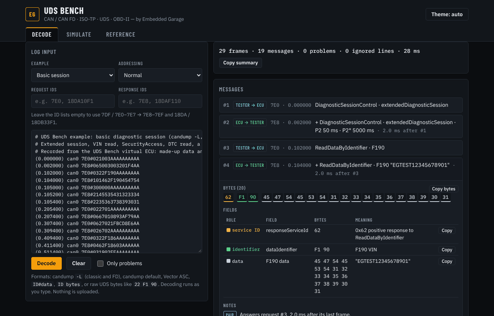
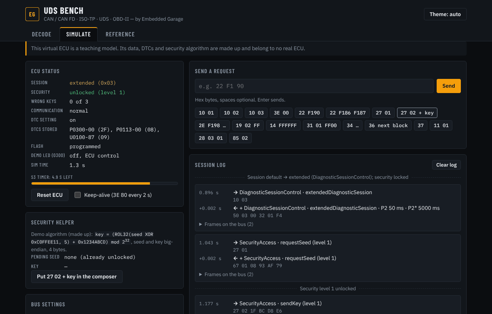
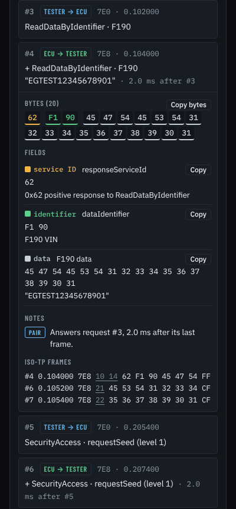

# UDS Bench

**Paste a CAN or CAN FD log and read every diagnostic message byte by byte, or talk to a virtual ECU and watch the
frames on the bus. One page, runs in your browser, nothing uploaded.** Built by **Embedded Garage**.







## Try it in 60 seconds

Open `dist/index.html` in a browser (no install, no server), then:

1. The page opens with a sample session already decoded: **29 frames, 19 messages, 0 problems**.
2. Click message **#4**. The VIN read expands: each byte is coloured by its role, and the data field reads
   `"EGTEST12345678901"`.
3. Pick **Error cases** from the Example list. The summary changes to **8 problems, 1 ignored line**, and each
   problem is named (sequence error, orphan frame, receiver overflow, invalid PCI, and more).
4. Open the **Simulate** tab and press the quick buttons **10 03**, **27 01**, then **27 02 + key**. The demo ECU
   switches to the extended session and its security state changes to **unlocked**.
5. Press **Open in Decode**. The frames you just exchanged are decoded in the Decode tab with **0 problems**.

For a full walk-through of every tab, see the [user guide](docs/USER_GUIDE.md).

## What it reads and decodes

- **Log formats:** candump `-L` (classic and CAN FD), candump default, Vector ASC (classic), `ID#data`, `ID bytes`, and
  raw UDS payloads such as `22 F1 90`. Unreadable lines are listed with their line number and the reason.
- **ISO-TP (ISO 15765-2):** single, first, consecutive and flow-control frames on classic CAN and CAN FD, including the
  CAN FD escape lengths, extended addressing and padding. Sequence errors, orphan frames, overflows and incomplete
  transfers are flagged on the frame where they happen.
- **UDS (ISO 14229-1):** every service in our spec, with each byte assigned to a named field, negative response codes
  (with a short hint for the common ones), DTCs with their status bits, and request/response pairing with latency.
- **OBD-II (SAE J1979):** a common subset of Mode 01/02 PIDs with their formulas, DTC lists and the VIN.
- **Virtual ECU:** sessions with an S3 timeout, SecurityAccess with lockout, data identifiers, DTCs, routines
  (including an erase that answers "response pending"), IO control and a full download flow. Every exchange shows its
  ISO-TP frames and can be sent to the decoder.
- **Reference:** service, NRC, ISO-TP, DTC-status, session and OBD-II formula tables.

The `examples/` folder holds the three logs offered by the Example list: a basic classic-CAN session, a CAN FD
programming flow, and a set of error cases.

## How it is built and checked

- **Zero runtime dependencies.** Plain JavaScript and CSS, no framework, no bundler, no npm packages. The build inlines
  everything into one self-contained page, `dist/index.html`, which works from disk or any static host. The only
  network request is for the fonts.
- **Unit tests.** `npm test` runs 97 `node:test` tests: every vector in [`docs/TEST_VECTORS.md`](docs/TEST_VECTORS.md),
  a segment-then-reassemble property test over classic and CAN FD framings, fuzz tests on random payloads, logs and
  requests, and a 10,000-frame performance test.
- **Cross-checked against four open-source libraries.** We compared our decoder and virtual ECU with python-OBD,
  can-isotp, udsoncan and python-can, used as independent oracles (no code copied). Headline numbers from
  [`docs/CROSSCHECK.md`](docs/CROSSCHECK.md):

  | Area | Oracle | Cases | Bugs found in UDS Bench |
  |---|---|---|---|
  | OBD-II formulas, PID masks, DTC text | python-OBD 0.7.3 | 170,748 | 0 |
  | ISO-TP segmentation and reassembly, plus fuzzed frame sequences | can-isotp 2.0.7 | 21,780 × 3 directions + 3,000 | 2, fixed |
  | UDS names, request encodings, response fields | udsoncan 1.26.1 | 167 names, 5,312 requests, 4,409 responses | 1, fixed |
  | candump `-L` and Vector ASC parsing | python-can 4.6.1 | 8,010 lines | 0 |
  | Virtual ECU driven by a real UDS client | udsoncan 1.26.1 | 42 steps | 0 |

  Each fixed bug has a regression test, and every remaining difference is classified with its reasoning.

## Accuracy and limits

Tables and behaviour come from the public ISO 14229-1, ISO 15765-2 and SAE J1979 documents. The simulated ECU is a
teaching model with made-up data and a made-up security algorithm; it is not any manufacturer's ECU. Check the current
standard before relying on a detail in a product.

Some table entries are not yet confirmed against the current editions. They are marked `// VERIFY` in the code and
listed in [`docs/VERIFY.md`](docs/VERIFY.md), each with what an independent library says about it. Version 0.1 has no
hardware access, no DBC/ODX files, no J1939, LIN or DoIP, and does not read Vector ASC CAN FD lines. Choices the spec
left open are recorded in [`docs/DECISIONS.md`](docs/DECISIONS.md), and [`PROGRESS.md`](PROGRESS.md) records what was
checked and how.

## Run and test

No dependencies. Node 20 or newer for the tests and the build script.

```
npm test          # unit tests (node:test)
npm run build     # writes dist/index.html, a single self-contained file
```

Open `dist/index.html` in a browser, or host the `dist` folder on any static host. The cross-check scripts are
dev-only and need Python; see [`tools/crosscheck/README.md`](tools/crosscheck/README.md).

## License

To be decided by the owner. Until then, all rights reserved.
